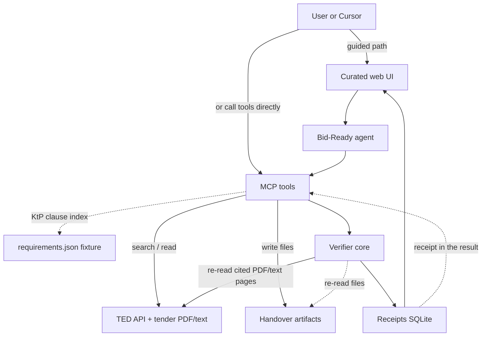

# Architecture

The web UI and MCP are two doors into the same six tools. The Bid-Ready agent plans the flow and never self-certifies. The verifier re-reads the tender itself, not only `requirements.json`.

## Components

- **Web UI** — curated path: onboard → ranked matches → Prepare bid → receipts → download ZIP
- **Bid-Ready agent** — orchestrates tool calls; never marks ready on its own word
- **MCP tools** — `find_tenders`, `score_tenders`, `check_eligibility`, `draft_cover_letter`, `verify`, `build_pack`
- **TED Search API + local tender PDF/text** — live search; confirm citations on pages
- **requirements.json** — human-curated fixture and clause index for TED 769674-2026 only. Eligibility may use it to know what to check. The verifier must confirm each cited clause against the actual PDF or extracted text.
- **Handover artifacts** — letter, checklist, receipts, `.ics`, ZIP
- **Verifier core** — domain-agnostic receipts, idempotency, status rules
- **Receipts (SQLite)** — `VERIFIED` / `UNVERIFIED` / `FAILED`

## Data flow



## Status rules (owned by the verifier core)

- `VERIFIED` — only if the observation from the tender page (or the pack file) matches the claim
- `FAILED` — observation conflicts with the claim, or a required file is missing
- `UNVERIFIED` — the source is down or a citation cannot be re-opened. `UNVERIFIED` is not done.

Retries with the same `idempotency_key` must return the first receipt and must not write a second file or fire a second side effect.

## MCP tools

Implement these signatures. Every tool writes a receipt before returning. Return JSON-serializable objects (plus a `receipt` or `receipts` field).

### `find_tenders`

```
find_tenders(
  query: str | None = None,
  place: str = "EL*",
  cpv: str = "72*",
  deadline_from: str = "20261116",
  limit: int = 10,
) -> list[Notice]
```

- Default query if `query` is omitted: `place-of-performance = EL* AND classification-cpv = 72* AND form-type = competition AND deadline-receipt-tender-date-lot >= 20261116`.
- POST `https://api.ted.europa.eu/v3/notices/search`. No API key. Timeout then fall back to the local pack and mark the live hop `UNVERIFIED`.
- Each `Notice` must include: `publication_number`, `title` (prefer `ell` then `eng`), `buyer_name`, `classification_cpv`, `deadline_date`, `deadline_time`, `place_of_performance`, `estimated_value` if TED returns one, `ted_url` (`https://ted.europa.eu/en/notice/-/detail/{publication-number}`).
- Must be able to load TED 769674-2026 by publication number even if it is not on the first page of results.

### `score_tenders`

```
score_tenders(notices: list[Notice], profile: CompanyProfile) -> list[ScoredNotice]
```

- Score with the formula in `docs/04-scoring.md` only. Do not use `requirements.json`.
- Return notices sorted by `fit_score` descending. Each item has `fit_score` (0–100) and `reason` (one sentence built from the four factors).

### `check_eligibility`

```
check_eligibility(notice_id: str, profile: CompanyProfile) -> EligibilityReport
```

- For `769674-2026`, use `data/tender-demo/769674-2026/requirements.json` as the clause **index** (what to check, section, pages). Confirm values against the extracted text or PDF page under `data/tender-demo/769674-2026/`.
- `EligibilityReport.rules[]`: `id`, `status` (`meets` | `missing` | `unclear`), `citation` (`section`, `pdf_page`, `printed_page`, `quoted_span` if available), `notes`.
- Cover at least: turnover, profitability, experience (escrow projects + SLA + transformation), ISOs, participation guarantee. Experience is `missing` only if the profile answered the public-sector projects question; otherwise `unclear`.
- `verdict`: `eligible` | `not_eligible` | `unclear`. For the demo small-firm profile on this tender: `not_eligible`, with a one-line partnership note.
- Also emit claims the verifier will grade, including the naive guarantee claim described in `docs/05-test-case-ktp.md`.

### `draft_cover_letter`

```
draft_cover_letter(
  notice_id: str,
  profile: CompanyProfile,
  eligibility: EligibilityReport,
) -> LetterArtifact
```

- Write the letter in Greek when the tender is Greek (ΚτΠ is).
- Frame it as consortium-partner outreach when the verdict is `not_eligible`.
- Return a path to a `.docx` or `.md` file (Markdown is acceptable if python-docx slips). ASCII file name, e.g. `consortium_letter_el.md`.

### `verify`

```
verify(run_id: str, claims: list[Claim] | None = None) -> list[Receipt]
```

- If `claims` is omitted, verify all claims stored for `run_id`.
- For each claim, re-open the cited tender PDF page or `text/` extract (see `docs/03-receipts-and-verifier.md`). Do not grade by re-reading `requirements.json` alone.
- Return the list of receipts. The run is not `ready` unless every required claim is `VERIFIED` or an intentional `FAILED` has been recorded and the pack is flagged not-ready.

### `build_pack`

```
build_pack(run_id: str, notice_id: str) -> PackArtifact
```

- ZIP contents (ASCII names only), e.g.:
  - `consortium_letter_el.md` (or `.docx`)
  - `eligibility_checklist.md`
  - `receipts.json`
  - `deadline.ics`
- `.ics`: Mon 7 Dec 2026, 14:00 Europe/Athens, `TZID=Europe/Athens` or UTC `20261207T120000Z`.
- Do not mark the pack `ready` if any required receipt is `FAILED` or `UNVERIFIED`.
- Return the ZIP path. Do not upload to ΕΣΗΔΗΣ.

## CompanyProfile (minimum fields)

```
{
  "name": str,
  "summary": str,
  "size": str | int,
  "location": str,
  "nuts_or_country": str,
  "cpv_codes": list[str],
  "turnover_2023_2025_total_eur": int | null,
  "certificates": list[str],
  "public_sector_projects_last_5y": str | list | null
}
```

`public_sector_projects_last_5y` is `null` if the onboarding question was skipped.

## Web UI flow

Single page or short wizard. No need for the user to know CPV codes.

1. Onboard: two lines or (extra) a website URL. Ask for turnover, certificates, and public-sector projects in the last 5 years.
2. Show a ranked shortlist with fit score and one-line reason. Do not auto-open the lowest-score tender as if it were the best fit.
3. "Prepare bid" runs eligibility + letter + verify.
4. Show the eligibility list, the letter, and receipts. Refuse to show "ready" until verify has finished. A `FAILED` guarantee receipt must be visible.
5. Download the ZIP. Copy states that a human signs and submits on ΕΣΗΔΗΣ.
